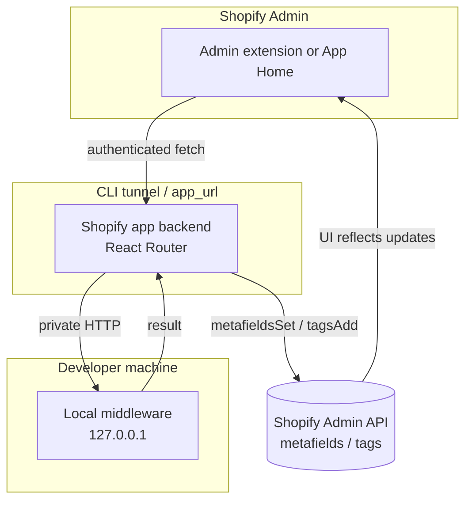
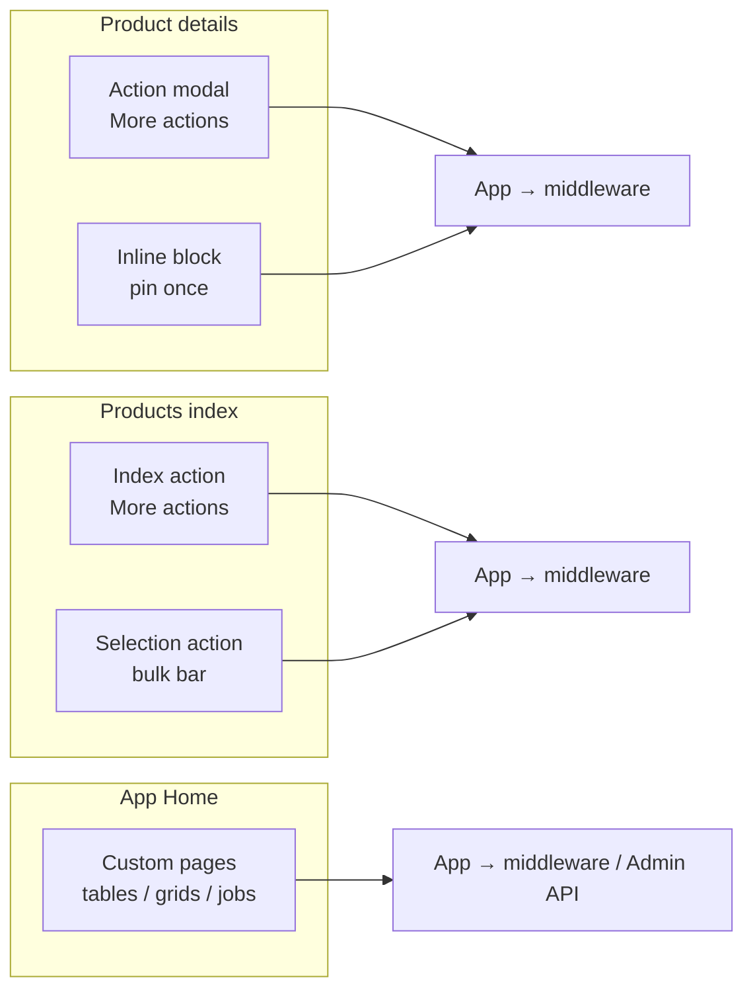
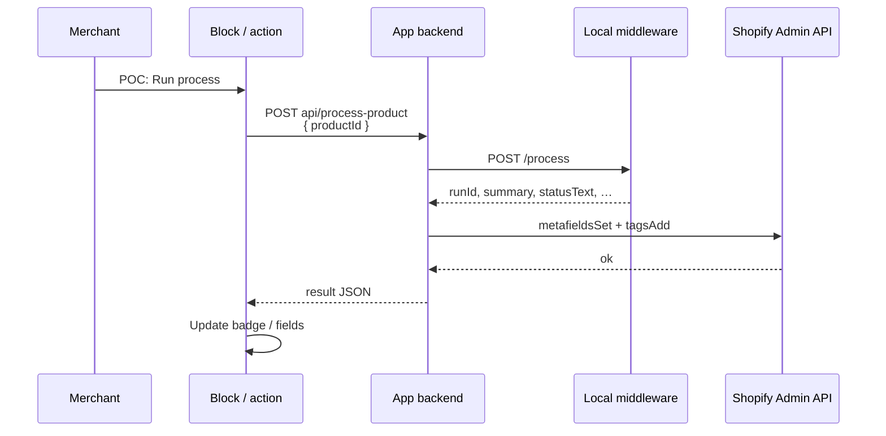
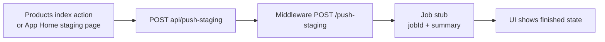
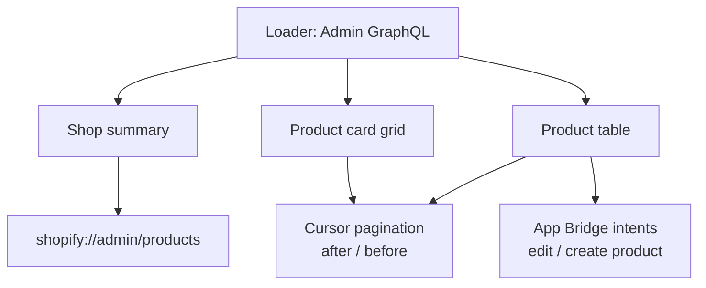
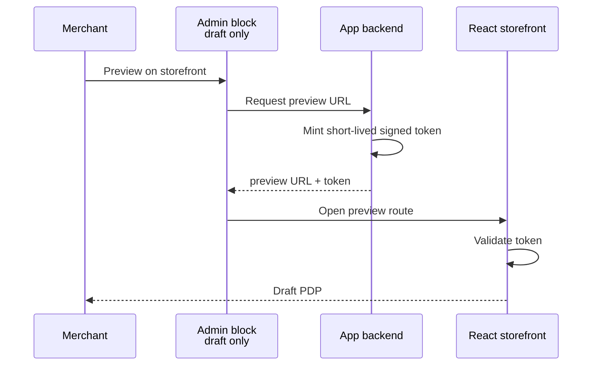
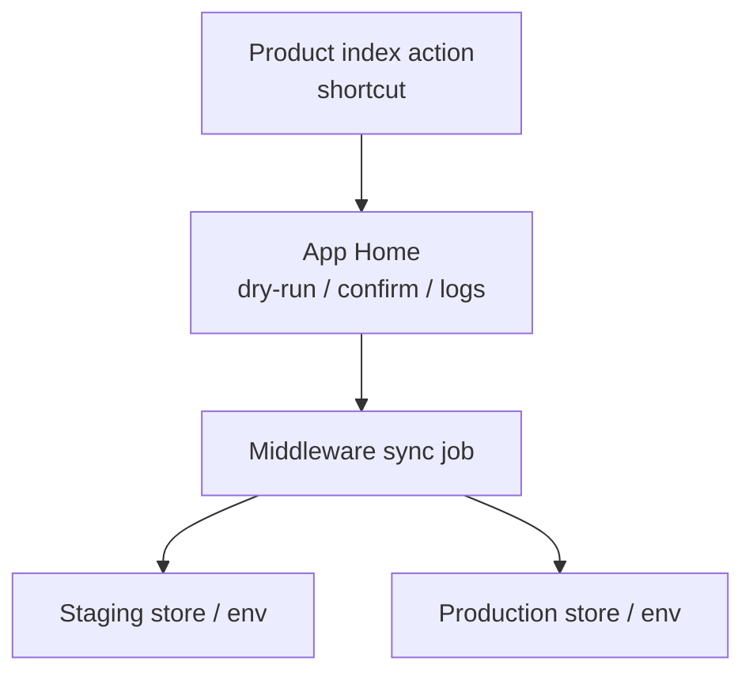

Learnings from the **Admin Extensions POC** app: how Shopify admin can be extended, how an app talks to local middleware, and what App Home can do vs inline blocks/actions.

**Code location (sibling of this Discovery repo):**

`/Users/viperdragon/PhpstormProjects/product-action-poc`

**Partner app name (example):** Admin Extensions POC  
**Dev store used:** tapestry-checkout-demo

---

## How to run locally

### Prerequisites

- Node.js 22+
- [Shopify CLI](https://shopify.dev/docs/api/shopify-cli) (`shopify version`)
- Partner / Dev Dashboard access
- A [development store](https://shopify.dev/docs/apps/build/dev-dashboard/development-stores)
- Logged into CLI (`shopify auth login` if needed)

### One-time setup

```bash
cd /Users/viperdragon/PhpstormProjects/product-action-poc
npm install
shopify app config link   # interactive: create or link Partner app
```

Ensure `shopify.app.toml` has:

- `scopes = "write_products"` (config link can wipe this — put it back if needed)
- Declarative product metafields for `$app.process_result` and `$app.process_status`
- `automatically_update_urls_on_dev = true`
- A real `shopify.web.toml` so the React Router backend starts under the tunnel (without it, App Home stays on a dead `example.com` / broken URL)

### Every session (two terminals)

```bash
cd /Users/viperdragon/PhpstormProjects/product-action-poc

# Terminal 1 — local middleware (localhost only; not public)
npm run middleware
# listens on http://127.0.0.1:4050

# Terminal 2 — Shopify app + Cloudflare tunnel + extensions
npm run dev
```

When CLI is ready:

1. Press **`p`** to open app preview (prefer this over a bookmarked Apps URL — tunnel hostnames change).
2. Install / open the app on the chosen dev store if prompted.
3. Keep both terminals running while testing.

### Where to click in the store admin

| Surface | Path in admin |
| --- | --- |
| Product action | Product → **More actions** → **POC: Run middleware process** |
| Product block | Product → **Blocks** → add/pin **POC: Middleware process** |
| Product index action | **Products** list → **More actions** → **POC: Push staging → production** |
| App Home demo UI | **Apps** → Admin Extensions POC → **POC: UI demo** |
| App Home staging job | **Apps** → Admin Extensions POC → **POC: Staging → prod** |

### Tunnel / “server IP could not be found”

`shopify app dev` uses a Cloudflare quick tunnel (`*.trycloudflare.com`). If Admin shows DNS errors for that host:

1. Quit (`q`) and restart `npm run dev`
2. Open via **`p`**, not an old tab
3. If tunnels stay broken, use a stable tunnel (e.g. ngrok) and `shopify app dev --tunnel-url https://your-host:port`

### Middleware smoke check

```bash
# with middleware already running
node middleware/self-check.mjs
```

### Optional env overrides

```bash
MIDDLEWARE_URL=http://127.0.0.1:4050/process
MIDDLEWARE_PUSH_URL=http://127.0.0.1:4050/push-staging
MIDDLEWARE_PORT=4050
```

---

## Architecture (remember this)



**Do not** call middleware directly from the extension. Extensions get automatic auth only to your app’s `app_url`. Middleware stays on localhost behind the app. No ngrok required for middleware in this POC.

### Where UI lives



---

## What we learned: admin surfaces

### You don’t customize arbitrary admin UI

Shopify exposes fixed **targets**. You add UI only there.

### Product details

| Target | UI | Use |
| --- | --- | --- |
| `admin.product-details.action.render` | Modal from **More actions** | Transactional “run process” |
| `admin.product-details.block.render` | Inline card (merchant pins once) | Persistent status + run button |

Also available later: print actions, configuration, purchase options, etc.

### Product index (bulk / catalog ops)

| Target | UI | Use |
| --- | --- | --- |
| `admin.product-index.action.render` | **More actions** on the list (no selection) | “Push all staging → production” style jobs |
| `admin.product-index.selection-action.render` | Bulk bar when rows are selected | Act on a subset |

Other resources (orders, customers, collections, …) have analogous targets.

### App Home (custom admin section)

Embedded app pages under **Apps → your app**:

- Full pages, nav, tables, grids, pagination
- Query Admin GraphQL with granted scopes
- App Bridge: toasts, intents (`edit:shopify/Product`), links to native admin (`shopify://admin/products`)
- Best place for long jobs, logs, dry-runs, staging→prod

**Not** a replacement for Shopify’s native Products screen — a parallel workspace that reads/writes the same data.

### Blocks have a height budget

Admin blocks are meant to stay around **~300px**. Taller content shows a yellow **“This Block is too tall”** warning in dev and may clamp / add “Show more”. Keep blocks short; put rich UI in App Home.

---

## Flows we built

### 1. Single product → middleware → Shopify update



Also in prose:

1. Merchant runs **POC: Run process** (action or block)
2. Extension `POST api/process-product` with product GID
3. App calls `POST http://127.0.0.1:4050/process`
4. Middleware returns `{ ok, runCount, runId, statusText, summary, detail, processedAt }`
5. App writes `$app.process_result`, `$app.process_status`, tags `poc-processed` / `poc-run-{runId}`
6. Block/modal updates from the response (no full page reload)

### 2. Staging → production stub (catalog-level)



Same pattern can later drive a real cross-store / environment sync.

### 3. App Home UI demo

Route: `/app/demo` (**POC: UI demo**)



- Status breakdown grid, 8 per page, deep link to native Products

---

## Key files in the POC repo

| Path | Role |
| --- | --- |
| `shopify.app.toml` | App config, scopes, metafield definitions |
| `shopify.web.toml` | Starts React Router under `shopify app dev` |
| `middleware/server.mjs` | Local stub: `/process`, `/push-staging`, `/health` |
| `app/routes/api.process-product.tsx` | Product job + metafields/tags |
| `app/routes/api.push-staging.tsx` | Catalog push stub |
| `app/routes/app.demo.tsx` | Tables / grids / pagination demo |
| `app/routes/app.staging.tsx` | App Home job page |
| `extensions/process-product/` | Product details action |
| `extensions/process-product-block/` | Product details block |
| `extensions/process-product-index/` | Product index action |

---

## Future ideas discussed (not fully built)

### Draft PDP preview on the React storefront



### Real staging → production



---

## Practical gotchas

1. **`shopify app config link` can clear scopes** — restore `write_products` (and any others).
2. **Without `shopify.web.toml`, the app backend never starts** — extensions “Failed to fetch” / App Home hits a useless URL.
3. **Restart middleware** after changing its JSON contract or the UI will show blanks (`run #?`, `poc-run-done`).
4. **Blocks must be pinned** once by the merchant on the product page.
5. **POC labels** in UI copy make it obvious which chrome is ours vs Shopify’s.

---

## Capability cheat sheet

| Need | Prefer |
| --- | --- |
| Context on one product | Block + action on product details |
| Act on many / whole catalog | Product index action or selection action |
| Lists, grids, pagination, jobs | App Home |
| Talk to internal systems | App backend → middleware |
| Open native Shopify screens | App Bridge intents / `shopify://admin/...` |
| Draft storefront preview | App-minted preview token + storefront route |
